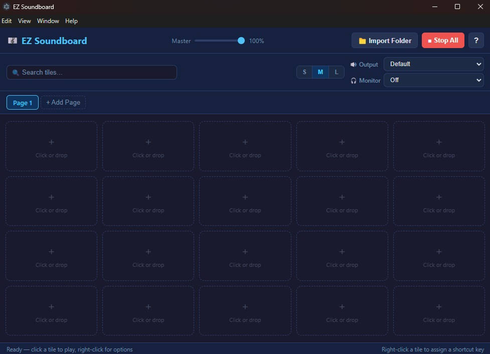

# EZ Soundboard

A lightweight desktop soundboard app built with Electron. Assign audio clips to tiles, organize them across pages, and route audio to Discord using a virtual audio cable.



---

## Download

**[⬇ Download latest release](https://github.com/Mootness/ez-soundboard/releases/latest)**

Run `EZ-Soundboard-Setup-<version>.exe` — it installs for your user account (no admin needed). The app checks for updates when it starts; one click on **Update now** downloads the update, installs it and reopens the app.

The installer isn't code-signed, so Windows may show "Windows protected your PC" the first time — click **More info → Run anyway**.

---

## Features

- **Tiles & Pages** — Organize sounds across multiple named pages
- **Keyboard Shortcuts** — Assign a key or combo (e.g. `Alt+1`, `Ctrl+Shift+F`) to any tile for instant playback
- **Global Hotkeys** — Optionally make shortcuts work while other apps (like games) are focused
- **Virtual Cable Support** — Route audio to Discord via VB-Cable (free), with a setup check that spots what's wrong
- **Mic Passthrough** — Mix your real microphone into the cable, so Discord hears your voice and your clips
- **Auto-level** — Every clip is measured once and played at the same loudness, so quiet clips aren't drowned out
- **Volume up to 200%** — Per tile and master, with a limiter that stops loud settings from distorting
- **Monitor Output** — Hear clips in your own headphones while Discord gets the primary output, with its own volume (the header's **Monitor** slider) so you can keep clips quieter in your ears than in Discord
- **Per-tile controls** — Individual volume, color labels, rename, and reassign
- **Import folder** — Bulk-add all audio files from a folder in one click
- **System tray** — Closing the window keeps the app running in the tray, so global hotkeys and Mic Passthrough keep working. Click the tray icon to open it again, or right-click it to stop all sounds or quit. Untick **Close to Tray** (in the tray menu or the Window menu) to make the close button quit instead
- **Tile sizes** — Switch between Small / Medium / Large grid layouts
- **Snaps anywhere** — Fits Windows snap positions (halves, corners, side strips); the layout compacts in small windows, and in short ones the search and output bar hides to leave room for tiles
- **Search** — Filter tiles by name instantly
- **Auto-updates** — New versions are offered in the app and install with one click

---

## Keyboard Shortcuts

Right-click a tile → **Set shortcut key**, then press a key or hold Ctrl / Alt / Shift and press a key for a combo.

By default shortcuts only work while EZ Soundboard is the focused window. Turn on **Global hotkeys** in the toolbar to make them work everywhere — in a game, in Discord, anywhere. While it's on, the keys you bind are captured system-wide (pressing them won't type in other apps), so combos like `Alt+1` or numpad keys are the safest choices. If a combo is already used by another app, the status bar says so and that shortcut keeps working only while EZ Soundboard is focused.

---

## Discord Audio Routing Setup

Discord records your **microphone**, not your speakers. To send soundboard clips into Discord you need a virtual audio cable.

1. **Install VB-Cable** (free) — download from [vb-audio.com/Cable](https://vb-audio.com/Cable) and run the installer as Administrator
2. **In EZ Soundboard** — set Output to the VB-Cable device (Windows calls it `CABLE Input (VB-Audio Virtual Cable)` or `Speakers (VB-Audio Virtual Cable)`), set Monitor to your headphones
3. **Keep your voice in Discord** — click **🎤 Mic** in the header (or turn on "Send my microphone" in Discord setup). The soundboard mixes your real mic into the cable and cleans up its background noise.
4. **In Discord** — Settings → Voice & Video:
   - **Input Device:** `CABLE Output (VB-Audio Virtual Cable)`
   - **Noise Suppression:** None — Discord's treats sound effects as noise and turns them down
   - **Echo Cancellation** and **Automatic Gain Control:** off
   - **Input Sensitivity:** turn off "Automatically determine" and drag the slider to the far left

Keep EZ Soundboard running while you're in a call: with Mic on, Discord hears your voice through it. Closing the window leaves it running in the tray; quitting it (right-click the tray icon → Quit) cuts your mic off in Discord.

The **?** button (or Help → Discord & Audio Setup) opens **Discord setup**, which checks your setup live. It shows whether VB-Cable is installed and used, whether your mic is going through, and whether Windows is turning the soundboard down during calls. It also has mic and volume settings, level meters and a test sound.

### Sounds quiet in Discord?

- **Auto-level** (on by default, in Discord setup) brings quiet clips up to a common level, and tile and master volumes go to 200%.
- **Discord's voice processing** is the most common cause: set Noise Suppression to None and turn off Echo Cancellation and Automatic Gain Control (step 4).
- **Windows turns other sounds down 80% during calls** by default, which can include the soundboard. Sound control panel → **Communications** tab → **Do nothing**. Discord setup warns when this is on, with a button to open it.
- **Check the cable's own levels:** Windows Sound settings → the VB-Cable playback device and `CABLE Output` recording device, both at 100%.

---

## Supported Formats

- **Audio:** MP3, WAV, OGG / OGA, Opus, FLAC, M4A, AAC, WebM / WEBA, MKA
- **Video** (plays the soundtrack): MP4, M4V, MOV, MKV, WebM, OGV, 3GP

Not supported: Apple Lossless (ALAC) `.m4a` files, and videos whose audio is AC3, E-AC3 or DTS (common in movie rips) — those play no sound, and the app tells you so.

---

## Build From Source

**Requirements:** Node.js 18+

```bash
git clone https://github.com/Mootness/ez-soundboard.git
cd ez-soundboard
npm install
npm start                # Run in development
npm run build            # Installer → dist/EZ-Soundboard-Setup-<version>.exe
npm run build:portable   # Single portable .exe that keeps its data next to itself
npm run publish          # Build and publish a GitHub release (needs GH_TOKEN)
```

Builds use `electron-builder`. The installer build also writes `dist/latest.yml`, which the in-app updater reads from the GitHub release. `brand-exe.js` runs during the build to give the app's exe its own name, version and icon.

---

## User Data

Your soundboard config (`soundboard.json`) is stored in:

- **Installed app and `npm start`:** `%APPDATA%\ez-soundboard\`
- **Portable build:** `EZSoundboard-data\` folder next to the exe

Audio files aren't copied — tiles point to your files where they are, so keep them in place.

Next to it, `soundboard.backup.json` is the board as it was the last time the app started. If `soundboard.json` is ever damaged, the app restores from that copy by itself and keeps the damaged file as `soundboard.damaged-<number>.json`. `app-settings.json` holds the **Close to Tray** setting.

---

## Troubleshooting Updates

- **"Couldn't start the installer"** — Windows or your antivirus refused to run the downloaded update. Click **Download manually**, or get the latest installer from the [releases page](https://github.com/Mootness/ez-soundboard/releases/latest) and run it yourself. Your soundboard is kept.
- **"The update didn't install"** — the installer started but the app is still on the old version, usually for the same reason. The manual download works here too.
- **"Smart App Control blocked…"** — some Windows 11 PCs have Smart App Control turned on. It only lets code-signed apps install, EZ Soundboard isn't code-signed, and Windows offers no "run anyway" for it. Downloading the installer manually is blocked the same way. Your choices:
  - **Keep the version you have.** It keeps working; you just don't get the update.
  - **Turn Smart App Control off**: Windows Security → App & browser control → Smart App Control settings → Off, then update or install again. It is a real protection, so that's your decision. On Windows with the April 2026 update or newer it can be turned back on later; on older versions, turning it off is permanent until Windows is reset. If you turn it back on, it may block the app again.
- **Asking for help** — **Help → Copy Diagnostic Info** copies the app version, whether Smart App Control is on, and the update log to the clipboard, ready to paste. The log itself is `%APPDATA%\ez-soundboard\updater.log`.

---

## License

MIT — see [LICENSE](LICENSE)

---

## Support

[](https://ko-fi.com/mootness)
